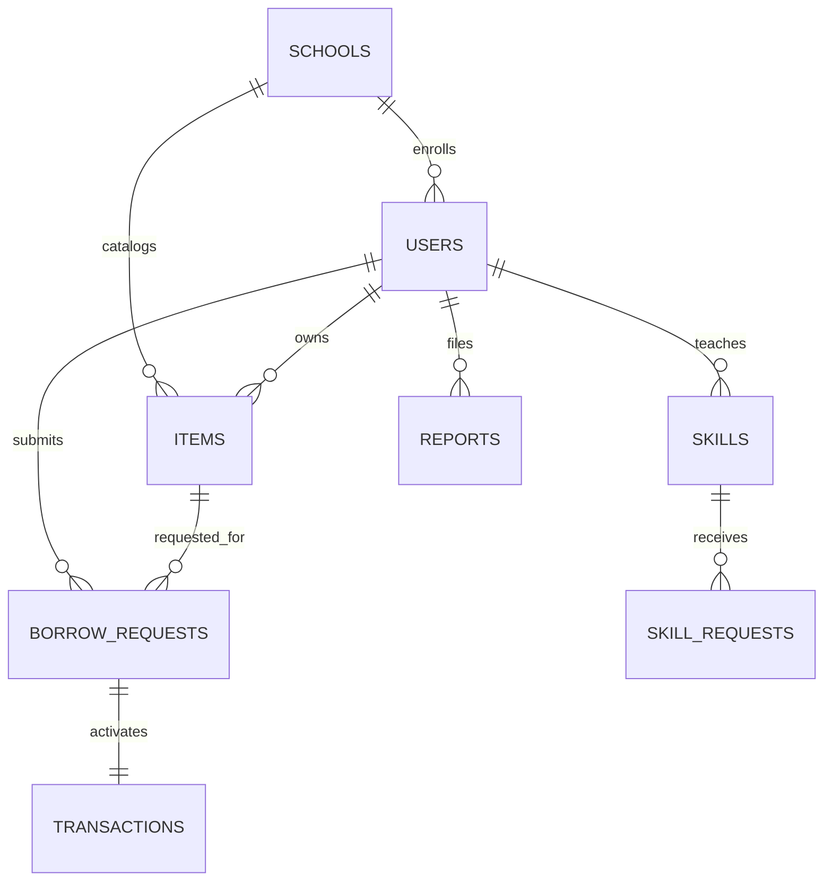

# 📦 BorrowBox — “Don’t buy it. Borrow it.”

> **A closed, verified school-community circular sharing platform where students lend, borrow, exchange, donate, and discover items or skills within Authpur National Model School.**

---

## 🌟 Venture Pitch Summary

Every academic semester, students spend thousands of dollars on single-use textbooks, graphing calculators, lab coats, and robotics kits needed for just 2–3 weeks of coursework or exams. Afterward, these items gather dust in lockers, parents overspend, and tons of equipment ends up in landfills.

**BorrowBox** solves this by establishing a zero-friction, authenticated campus circular economy:
- **100% Closed & Verified:** Only students and faculty with institutional emails (`@authpurmodel.edu`) can enter.
- **Safe Campus Exchange Points:** Physical exchanges are strictly routed through school-monitored desks (*Library Desk, Reception, Activity Room, Lab Counter*).
- **Fraud-Proof Handover:** Temporary 6-digit verification codes confirm physical handoffs before loans activate.
- **Skill Swap Module:** Enables peer-to-peer knowledge and tutoring trades without cash friction.
- **Measurable ESG Impact:** Generates automated sustainability audits (Items Reused, Money Saved, Landfill Waste Avoided) for school boards.

---

## 🎨 Design System & UI Specs

Designed specifically for teenagers, high schoolers, and university students—styled like a sleek, venture-backed startup.

| Token | Hex Value | Role |
| :--- | :--- | :--- |
| **Primary** | `#2563EB` | Royal Deep Blue (actions, branding, primary buttons) |
| **Secondary / Accent** | `#10B981` | Emerald (trust badges, savings, sustainability) |
| **Background** | `#F8FAFC` | Off-white / Cool Grey page canvas |
| **Surface Cards** | `#FFFFFF` | Pure White with 16px radius and soft elevation |
| **Text Primary** | `#0F172A` | Slate 900 for crisp, readable typography |
| **Text Muted** | `#64748B` | Slate 500 for secondary metadata and timestamps |

- **Typography:** `Plus Jakarta Sans`, clean sans-serif with strong hierarchy.
- **Navigation:**
  - **Mobile:** Sticky bottom navigation bar (`Home`, `Discover`, `List (+)`, `Activity`, `Profile`).
  - **Desktop/Tablet:** Left collapsible sidebar with navigation links, school status, profile directory, and sustainability progress.

---

## 🏗️ Architecture & Database Schema

The backend is built with **Python (Starlette ASGI + SQLite3 + Pydantic 2)**, delivering high speed, zero-bloat REST endpoints, and relational integrity.



### Relational Tables
1. **`users`**: `id`, `fullName`, `displayName`, `schoolId`, `grade`, `email`, `avatarUrl`, `verificationStatus`, `trustScore`, `role`, `createdAt`
2. **`schools`**: `id`, `name`, `domain`, `verificationCode`, `adminId`, `approvedLocations` (JSON array of strings)
3. **`items`**: `id`, `ownerId`, `schoolId`, `title`, `category`, `description`, `images` (JSON array), `condition`, `maxBorrowDays`, `terms`, `deposit`, `exchangeLocation`, `status`, `createdAt`
4. **`borrow_requests`**: `id`, `itemId`, `borrowerId`, `ownerId`, `startDate`, `endDate`, `message`, `status`, `createdAt`
5. **`transactions`**: `id`, `requestId`, `itemId`, `ownerId`, `borrowerId`, `exchangeCode` (6-digit one-time code), `borrowedAt`, `dueDate`, `returnedAt`, `status`
6. **`skills`**: `id`, `userId`, `schoolId`, `skillTitle`, `description`, `durationMinutes`, `desiredExchange`, `availability`, `createdAt`
7. **`skill_requests`**: `id`, `skillId`, `requesterId`, `message`, `status`, `createdAt`
8. **`reports`**: `id`, `reporterId`, `reportedUserId`, `itemId`, `reason`, `status`, `createdAt`
9. **`notifications`**: `id`, `userId`, `type`, `message`, `isRead`, `createdAt`
10. **`impact_stats`**: `id`, `itemsReused`, `moneySaved`, `wasteAvoidedKg`, `successfulExchanges`

---

## ⚡ Core Features & User Flows

### 1. Profile Creation, Editing & User Switching
- **Create New Profile (`➕ Create Profile`):** Register new student or faculty accounts with custom full name, nickname, grade (Grade 9–12, Faculty, Admin), institutional email, and quick preset avatar picker.
- **Edit Current Profile (`✏️ Edit Profile`):** Update personal details, nickname, grade division, or avatar anytime.
- **Switch Between Campus Users (`🔄 Campus Directory`):**
  - Instant dropdown selector in the top navigation bar.
  - Interactive visual card grid in the **Profile & Directory (`#profile`)** view showing all campus students and administrators with their trust scores and active badges.
  - One-click profile switching preserves session state and immediately updates all active views.

### 2. Authentication & Closed-School Verification
- School domain restriction (`@authpurmodel.edu`).
- Verified school badge in header with clickable security explanation modal for **Authpur National Model School**.
- Pre-seeded student and faculty personas:
  - **Maya Lin** (Active Student Borrower, Grade 11)
  - **Aarav Sharma** (Active Student Lender, Grade 12)
  - **Dr. Anita Roy** (School Principal / Admin)
  - **Liam Vance** (Grade 10)
  - **Sofia Chen** (Grade 11)

### 3. Home Dashboard
- Dynamic greeting: *"Good morning, [Student Display Name]!"*
- Instant search bar with auto-redirect to marketplace.
- 4 Quick Action Cards: `🔎 Find Items`, `📦 List an Item`, `🤝 Skill Swap`, `📋 My Borrowings`.
- **Live Community Impact Widget**: Displays 1,248 Items Reused, ₹2.4L Saved, 1,248 Safe Exchanges, and 384 kg Waste Avoided.
- **Popular in Authpur**: Horizontal scrollable carousel featuring high-demand items (Casio calculators, SL Arora physics books, Arduino kits).

### 4. Signature Feature: "Need It Once?" Nudge
- Accessible via the top bar or triggered when searching and listing.
- Interactive prompt: **"Do you actually need to own this?"**
  - **"I need it temporarily"**: Filters catalog to available loan items.
  - **"I want to own it"**: Highlights items marked for permanent donation or giveaway.
  - **"I'm not sure"**: Recommends borrowing for 3 days to test before spending money.

### 5. Item Discovery & Search Marketplace
- Filters by Category (*Books, Study Equipment, Art Supplies, Sports, Costumes, Electronics, Music, Project Tools, School Supplies*), Condition (*Like New, Excellent, Good, Fair*), and availability.
- Item cards display image, condition badge, owner avatar, trust count, exchange point, and refundable deposit.

### 6. Safe Exchange & 6-Digit Verification Code
- When an owner approves a borrow request, BorrowBox generates a temporary **6-digit random code** (e.g. `482913`) and an accompanying QR code.
- Both parties meet at an **approved school desk** (*School Library Desk, Main Reception, Student Activity Room, Science Lab Counter*).
- Borrower confirms handover by submitting the 6-digit code.

### 7. Active Loans & Return Confirmation (My BorrowBox)
- 4 clean tabs: `Borrowing`, `Lending`, `Requests`, `History`.
- Displays progress bar (e.g., *"4 days remaining"*), due date, and return trigger.
- **Two-Step Return Verification:** Borrower clicks "Mark as Returned" (drops item off at school desk); owner confirms receipt in good condition. Increases community trust scores and automatically logs savings!

### 8. Skill Swap Module
- Non-monetary peer tutoring and skill exchanges (*e.g., "Python Coding Basics (30 mins)" in exchange for "Guitar Chord Lessons"*).
- Direct proposal flow with acceptance status.

### 9. Student & School Impact Analytics
- **Personal Impact Page**: Displays individual savings (₹), waste avoided (kg), and badging (*🏆 Community Helper, 🌱 Reuse Champion, ⚡ Fast Returner, 📚 Study Buddy*).
- **School Administrator Dashboard**:
  - Moderation center for flagged listings and reports.
  - Management of approved school drop-off desks.
  - One-click exportable **School Sustainability Board Report** for green school accreditation.

---

## 🎬 2-Minute Competition Demo Flow

Follow these steps for an instant demo:

1. **Step 1: Home Dashboard & Authpur Network**
   - Start at `http://127.0.0.1:8080/`. Notice the live counters (1,248 items reused, ₹2.4L saved) and school badge for **Authpur National Model School**.
   - Click **"💡 Need It Once?"** in the top bar to test the decision nudge.
2. **Step 2: Profile Creation & Editing**
   - Click **"+ Profile"** in the top navbar (or navigate to **Profile & Users** in the sidebar).
   - Enter a new student profile (e.g., Full Name: *"Rohan Mukherjee"*, Grade: *Grade 11*, pick an avatar). Click **"Create & Switch to Profile"**.
   - Notice the toast confirmation and how the app immediately switches to Rohan!
   - Click **"✏️ Edit Profile"** to change the display nickname or grade, save, and see live updates.
3. **Step 3: User Switching via Campus Directory**
   - Scroll down to **"🔄 Switch Between Campus Users"** on the Profile page.
   - Click **"Switch to this User"** on **Maya Lin** (Active Borrower).
   - Go to **My BorrowBox (`#activity`)** → **Borrowing Tab**.
   - See the active loan for the **Casio FX-991ES Plus Calculator** with the "4 Days Remaining" progress bar.
   - Click **"Mark as Returned (Drop-off)"**.
4. **Step 4: Owner Return Confirmation**
   - In the top bar persona dropdown (or Profile directory), switch to **Aarav Sharma** (Lender).
   - Go to **My BorrowBox** → **Lending Tab**.
   - Click **"✓ Confirm Received in Good Condition"**.
   - Watch the trust score increase and ₹1,500 added to the community savings!
5. **Step 5: Administrator View & Sustainability Audit**
   - Switch persona to **Dr. Anita Roy (Principal)**.
   - Click **School Admin (`#admin`)** in the sidebar to review campus drop-off desks and click **"📄 Export Sustainability Report"** for Authpur National Model School.
6. **Reset Demo:**
   - Click **"↺ Reset"** in the top bar anytime to return the database to the initial seed state.

---

## 🚀 Running the Application

```bash
# 1. Start the BorrowBox server
./run.sh
# Or directly:
python3 app.py
```

Open your browser to:
```
http://127.0.0.1:8080/
```

---

## 📂 Repository File Structure

```
borrowbox/
├── app.py              # Starlette ASGI backend, Profile CRUD & REST API routes
├── database.py         # SQLite schema, queries, user creation/editing & seed data
├── models.py           # Pydantic typed schemas for API serialization
├── run.sh              # Bash launcher script
├── static/
│   ├── index.html      # Responsive single page application (Authpur network, modals & Profile view)
│   ├── css/
│   │   └── style.css   # Modern design system (tokens, shadows, cards, exchange code styling)
│   └── js/
│       ├── api.js      # REST API client with profile creation & user switching
│       └── app.js      # Reactive application controller, router, modals, profile management
└── README.md           # Documentation, architecture, and competition demo guide
```
